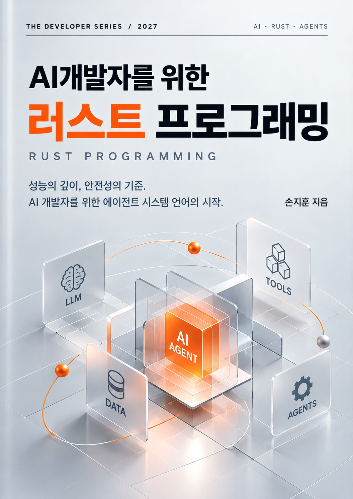

# AI 개발자를 위한 러스트 프로그래밍

<p align="center">
  
</p>

> 성능의 깊이, 안전성의 기준.  
> AI 개발자를 위한 에이전트 시스템 언어의 시작.

이 저장소는 AI 개발자를 위한 러스트 프로그래밍》의 학습 및 실습 코드를 정리한 공간입니다. 
러스트의 기본 문법부터 소유권과 동시성, 외부 크레이트 활용, 자동미분과 딥러닝 프레임워크까지 단계적으로 다룹니다.

- 저자: 손지훈
- 주제: Rust · AI · Agents
- 예제 코드: [`src`](./src)

## 저장소 구성

각 장의 예제 코드는 `src/chapter_...` 형식의 폴더에 수록되어 있습니다. 파일명 앞의 번호는 해당 장에서 코드가 소개되는 순서를 나타냅니다.

```text
src/
├── chapter_2_1/
├── chapter_2_2/
├── ...
└── chapter_4_4/
```

## 책 목차

### 1부. 러스트(Rust) 기초

| 목차 | 페이지 |
|---|---:|
| Chapter 1-1장. 러스트(Rust) 프로그래밍 언어와 AI, 왜 지금 러스트인가? | 7 |
| Chapter 1-2장. AI를 위한 프로그래밍 언어 비교(러스트 vs C++ vs 파이썬) | 10 |
| Chapter 1-3장. 러스트 개발 환경 구축하기 (Windows 기준) | 13 |
| Chapter 1-4장. 첫 번째 러스트 프로젝트 만들고 구조 이해하기 | 18 |
| Chapter 1-5장. 자주 쓰는 필수 명령어 마스터하기 (rustup vs cargo) | 22 |

### 2부. 러스트(Rust) 문법

| 목차 | 페이지 |
|---|---:|
| Chapter 2-1장. 메인 함수와 프로그램 진입점(Entry Point) | 25 |
| Chapter 2-2장. 주석과 문서화 코드(Comments) | 35 |
| Chapter 2-3장. 기본 데이터 타입 (스칼라 및 컴파운드) | 38 |
| Chapter 2-4장. 변수(가변성)와 상수 | 44 |
| Chapter 2-5장. 기본 출력과 형식 지정자(Formatting) | 50 |
| Chapter 2-6장. 함수(Functions)와 반환값(Return Value) | 53 |
| Chapter 2-7장. 제어문 (if 조건문과 loop/while/for 반복문) | 62 |
| Chapter 2-8장. 러스트의 핵심: 소유권(Ownership)과 이동(Move), 빌려주기(Borrowing) | 75 |
| Chapter 2-9장. 컬렉션 타입 (Vector, HashMap, HashSet) | 93 |
| Chapter 2-10장. 문자열의 비밀 (char, &str, String의 삼각관계) | 121 |
| Chapter 2-11장. 구조체(Struct)와 메서드 구현(impl) | 146 |
| Chapter 2-12장. 열거형(Enum)과 패턴 매칭(match) | 163 |
| Chapter 2-13장. 제네릭(Generic)과 라이프타임과 트레잇(Trait) | 180 |
| Chapter 2-14장. 반복자(Iterator)와 클로저(Closure) | 218 |
| Chapter 2-15장. 스마트 포인터 (Box, Rc, Arc) | 234 |
| Chapter 2-16장. 강력한 에러 핸들링 (Result와 Option) | 263 |
| Chapter 2-17장. 모듈 시스템과 크레이트(Crate) 분할 | 278 |
| Chapter 2-18장. 커맨드라인 인수 처리 및 로그 시스템 구축 | 291 |
| Chapter 2-19장. 파일 시스템 입출력 (고속 텍스트/바이너리 읽기) | 297 |
| Chapter 2-20장. 네트워크 입출력 (TCP/UDP 소켓 통신) | 310 |
| Chapter 2-21장. 멀티스레딩(Thread)과 동시성 데이터 공유 | 316 |
| Chapter 2-22장. 비동기 프로그래밍 (async/await와 Tokio 런타임) | 346 |
| Chapter 2-23장. 코드 위에 그리는 마법, 디라이브(Derive) 매크로 | 355 |

### 3부. 러스트(Rust) 외부 라이브러리(Crates)

| 목차 | 페이지 |
|---|---:|
| Chapter 3-1장. serde: AI 데이터를 위한 초고속 데이터 직렬화/역직렬화 | 369 |
| Chapter 3-2장. ndarray: 러스트로 구현하는 다차원 행렬 및 텐서 연산 | 381 |
| Chapter3-3장. rayon: AI 데이터 전처리를 위한 초고속 병렬 처리 | 397 |
| Chapter 3-4장. Tokio: AI 서버를 위한 비동기 프로그래밍 기초 | 405 |
| Chapter 3-5장. 텍스트 임베딩: Hugging Face Tokenizer와 Embedding의 원리 | 414 |
| Chapter 3-6장. Qdrant: 벡터 검색(Vector Search)과 RAG의 기초 | 422 |

### 4부. 러스트(Rust)와 실전 AI 개발(고급 인공지능 프레임워크 구축)

| 목차 | 페이지 |
|---|---:|
| Chapter 4-1장. Rust로 알아보는 자동미분(AutoGrad) | 431 |
| Chapter 4-2장. Rust로 구현하는 딥러닝 신경망과 학습 과정 | 444 |
| Chapter 4-3장. Rust로 구현하는 XOR 문제와 역전파 학습 | 462 |
| Chapter 4-4장. Burn: Rust 네이티브 딥러닝 프레임워크 | 477 |
| Chapter 4-5장. Rust AI 생태계와 미래 | 584 |

## 표지 이미지 추가 방법

표지 이미지 파일을 이 저장소의 최상위 폴더에 `book-cover.png`라는 이름으로 업로드하면 이 페이지 상단에 자동으로 표시됩니다.

